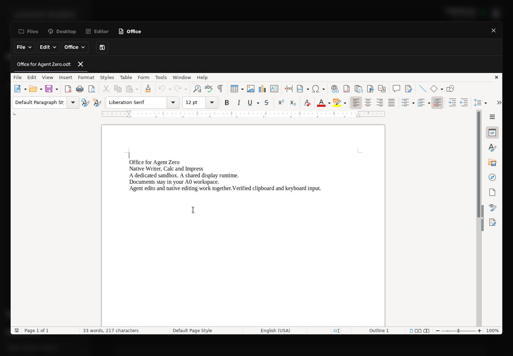

# Office for Agent Zero

Writer, Calc and Impress inside Agent Zero — with native LibreOffice editing and agent-assisted document workflows.

A standalone community plugin for **Agent Zero v3**. LibreOffice installs automatically in its own persistent sandbox the first time you use Office. The viewer reuses A0's Tuxee display bundle and noVNC transport; no Xpra, Xfce or Collabora server is needed.



## Install

In **Plugins → Hub**, install from Git URL:

```text
https://github.com/agent0ai/a0-plugin-office
```

Enable **Office**, then select the Office surface or ask your agent to create a document. First use needs internet access and can take several minutes; progress appears in the Office panel. Concurrent requests share one installation, and subsequent starts reuse it.

Requires a current Linux A0 v3 Docker image with the Sandboxing plugin and shared Tuxee bundle. No extra Docker privileges, ports or host packages are required beyond A0's normal sandbox setup. This repository is a plugin, not a separate Docker service. If both Browser and Desktop were disabled when A0 started, restart A0 after enabling Office to mount the shared viewer route.

If an older v3 build fails with `ucf: do not have write privilege`, update and restart A0, then retry Office. The fix is in A0’s shared sandbox runtime; reinstalling the plugin alone is insufficient. Existing sandbox files can be retained.

## What it does

- Create, open, read and edit **ODT, ODS, ODP, DOCX, XLSX and PPTX**. ODF is the default.
- Edit interactively in native LibreOffice, in a floating window or the right canvas.
- Use the `office_artifact` tool and bundled Writer, Calc and Impress skills for text, spreadsheet cells/formulas/charts and slides.
- Save, rename, Save As, export to compatible Office formats or PDF, and restore saved versions.
- Keep native edits and agent edits synchronized, with conflict detection for files changed outside Office.

Text and Markdown remain in A0's Editor. Format-specific editing limits are described in the bundled skills; structural rewrites can simplify complex formatting. LibreOffice's compatibility with Microsoft Office is not pixel-perfect.

Use **File → New** (or the Office menu) to start a document. **Save** asks for its name and location the first time; **Save As** creates a separate copy. The toolbar Save icon appears only with an open document. Ctrl+S works inside the viewer. Open uses a separate, scrollable file dialog.

Docking into the sidebar requires an open chat; the standalone window disables its dock button until one exists.

## Storage and lifecycle

One shared Office sandbox serves all documents; each document has its own LibreOffice window. Only selected files are staged into it, not the whole A0 user directory. Dependencies stay out of the main Python environment. Debian's `python3-uno` brings the Python interpreter matching LibreOffice's UNO ABI; no additional virtual environment is created.

Agent-created documents default to `usr/workdir/documents` or the active project's documents folder. New UI documents use recovery files in the workdir’s `.office-drafts/` directory until first Save moves them to the chosen destination. Metadata and private version backups live in `usr/office/documents`. Persist **`/a0/usr`** to retain documents, history and installed sandbox packages.

Disabling or updating stops Office after saving open documents. Uninstall also removes its sandbox and viewer registration, while preserving host documents and version history. Use Office's Save/Save As controls for host destinations; LibreOffice's native file picker sees the sandbox filesystem. Unsaved in-memory edits can be lost if the container is forcibly killed. Macros and automatic external-link updates are disabled when opening documents.

## Development

Place this repository at `/a0/usr/plugins/office` in a disposable A0 v3 container. Run host regression tests with its framework interpreter:

```sh
cd /a0
python -m pytest usr/plugins/office/tests -q
```

Guest format libraries are installed only on first Office use. See [AGENTS.md](AGENTS.md) for ownership and verification contracts and [verification notes](docs/verification.md) for the tested environment and limitations.

MIT licensed. Document algorithms and display integration derive from [Agent Zero](https://github.com/agent0ai/agent-zero); LibreOffice, Tuxee and noVNC retain their respective upstream licenses.
